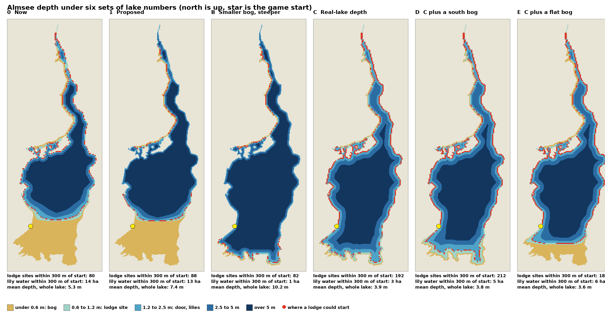

# Lake depth

Design note, session 30. The author found the lake too shallow on the tablet.
This note records what was measured, the five sets of numbers that were tried
against the current one, and the set chosen (set E). Set E is built into the tiles
(session 31, #157). The work is tracked in the issue linked at the end.

## What was wrong

The lake bed is made up by `tools/tiles/build_tiles.py` (the BEV lake is flat).
It starts `LAKE_BED_OFFSET` below the lake level at the shore and deepens by
`LAKE_BED_SLOPE` for each metre from the shore. In the south bog the bed is
flattened to `BOG_BED_OFFSET`, with a weight from 0 (open water) to 1 (full bog).

- The start (63, 1750) lies on the west edge of the bog. The bog is 0.3 m flat
  from z 1700 southward, and 69% of the water within 300 m of the start is under
  0.6 m deep.
- Offset and slope are multiplied by (1 minus the bog weight), so changing them
  does nothing in the bog. The first proposal (offset 0.8, slope 0.25) therefore
  left the start as it was.
- The open lake was already deep: mean 5.3 m for the Almsee, against 2.5 m for
  the real lake (maximum 5 m), and 54% of it is deeper than 2.5 m.
- Lily pads need 0.3 to 2.5 m of water, a lodge site needs 0.1 to 1.2 m with a
  door of 1.2 m or more 2.9 m and 5.9 m out, and diving needs 1 m or more. The
  bog is too flat and shallow for the door and the dive.

## How it was measured

A script (not in the repo) loads the same BEV terrain, lake polygons, and land
cover as the tile tool and rebuilds the lake bed on the 5 m grid with each set of
numbers. The "now" baseline matches the depth bands read from the built tiles.
Lodge sites are 5 m grid points that pass the `checkSpot` rule. "Near start" is
within 300 m of the start. The 2 m fine tiles are not modelled, so the numbers
are estimates. All figures are for the Almsee (89 ha).

## The sets

| Set | Open water offset (m) | Slope | Max depth (m) | Bog |
| --- | --- | --- | --- | --- |
| 0 Now | 0.5 | 0.12 | 14 | z 1100 to 1700, flat 0.3 m |
| 1 Proposed | 0.8 | 0.25 | 14 | unchanged |
| B | 0.6 | 0.20 | 14 | z 1700 to 2200, reach 30 m |
| C | 0.6 | 0.06 | 5 | z 1700 to 2200, reach 30 m, bog slope 0.02 |
| D | 0.6 | 0.06 | 5 | z 1750 to 1950, reach 30 m, bog slope 0.02 |
| E | 0.6 | 0.06 | 5 | z 1750 to 1950, reach 30 m, bog slope 0 |

| Measure | 0 Now | 1 | B | C | D | E |
| --- | --- | --- | --- | --- | --- | --- |
| Near start, under 0.6 m | 69% | 67% | 2% | 2% | 3% | 18% |
| Near start, over 2.5 m | 16% | 23% | 92% | 77% | 68% | 60% |
| Lodge sites, whole lake | 1122 | 480 | 540 | 1934 | 1964 | 1828 |
| Lodge sites near start | 80 | 88 | 82 | 192 | 212 | 188 |
| Nearest lodge site | 143 m | 111 m | 154 m | 9 m | 7 m | 7 m |
| Lily water near start | 14 ha | 13 ha | 1 ha | 4 ha | 6 ha | 7 ha |
| Lily water, whole lake | 40.8 ha | 32.3 ha | 11.0 ha | 26.2 ha | 29.0 ha | 31.3 ha |
| Diveable water, whole lake | 59.9 ha | 63.1 ha | 85.0 ha | 80.8 ha | 79.0 ha | 73.1 ha |
| Diveable water near start | 4.6 ha | 5.3 ha | 17.0 ha | 16.5 ha | 15.8 ha | 13.3 ha |
| Bog under 0.6 m, whole lake | about 26 ha | | | 2.2 ha | 3.1 ha | 11.0 ha |
| Mean depth | 5.3 m | 7.4 m | 10.2 m | 3.9 m | 3.8 m | 3.6 m |

Lily water is 0.3 to 2.5 m deep, diveable water is 1 m or more. Empty cells were
not measured.

## Decision: set E

Set E is the author's choice. It keeps most of the gain of set C and still has a
real flat bog:

- A lodge can start 7 m from the start, with 188 sites within 300 m, against 80.
- Diveable water near the start rises from 4.6 ha to 13.3 ha.
- The open lake gets a real-lake maximum of 5 m and a gentle shelf, so the water
  deepens by 0.06 m for each metre from the bank.
- 11 ha of flat bog stays in the far south, so lily pads and the bog character
  survive. Lily water near the start is half of today (7 ha against 14 ha).

The values for `tools/tiles/build_tiles.py`:

| Constant | Now | Set E |
| --- | --- | --- |
| `LAKE_BED_OFFSET` | 0.5 | 0.6 |
| `LAKE_BED_SLOPE` | 0.12 | 0.06 |
| `LAKE_BED_MAX` | 14.0 | 5.0 |
| `BOG_RAMP_Z` | (1100, 1700) | (1750, 1950) |
| `BOG_WETLAND_REACH` | 60 | 30 |
| `BOG_BED_OFFSET` | 0.3 | 0.3 (unchanged) |

Bog slope 0 is what the current formula already does, so no new constant is
needed. The lodge rules (`SITE_MIN_DEPTH`, `SITE_MAX_DEPTH`, `DOOR_MIN_DEPTH`,
`DOOR_RUN`) and the lily depths stay as they are.

## Not decided

- Lily water near the start is half of today. Moving the north edge of the bog
  zone up toward z 1650 would put more of it at the start's shore. Try this on
  the tablet first.
- The 0.06 slope makes a 1.2 m door about 10 m from the bank. Whether the dive and
  the store feel right there is unseen on the tablet.
- The real lake is 2.5 m deep on average and set E is 3.6 m. A shallower lake
  than that has not been tried.
- The other lakes in the game were not measured. The bog zone is set by z, not by
  lake, so it acts on every lake south of z 1750. Lakes in the north (z -4600 to
  -1400) had no bog before and have none now. Lakes far south (z 7800 to 8800)
  were flat 0.3 m bog already, since the old ramp was full from z 1700, and they
  still are. Set E only moves the start of the bog from z 1100 to 1750. The far
  lakes were not looked at one by one.
- The tiles were rebuilt with set E in session 31 and the tile checks pass. The
  2 m fine tiles use the same bed code and changed with it. The camera demo scene
  was not re-cut and ADR 0008 has no depth numbers, so it needs no change.

Issue: [#157](https://github.com/ricschuster/beaver_cycle/issues/157)

Related: [03_location.md](03_location.md) (the game lake is deeper than the real
one), [16_food_store.md](16_food_store.md) (door and store depth), and ADR 0002 and
ADR 0008 (terrain).
